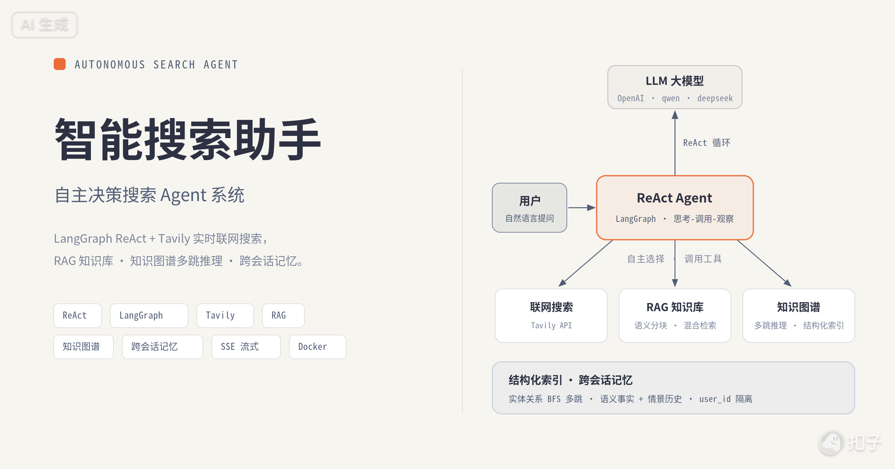

---
AIGC:
    Label: "1"
    ContentProducer: 001191110102MACQD9K64018705
    ProduceID: 7642208309482733858-data_volume/files/所有对话/主对话/qa-sysyywe_README_k8s更新.md
    ReservedCode1: ""
    ContentPropagator: 001191110102MACQD9K64028705
    PropagateID: 467726794233428#1792053335586
    ReservedCode2: ""
---
# 智能搜索助手 (qa-sysyywe)

**自主决策搜索 Agent 系统** —— 基于 LangGraph (ReAct) + Tavily + FastAPI + Next.js 16，面向生产环境的实时联网问答平台。内置知识图谱多跳推理与跨会话记忆，具备完整的可观测性、安全护栏与企业级评测门禁。

<p align="center">
  
</p>

<p align="center">
  <a href="https://github.com/231dff/qa-sysyywe"></a>
  
  
  
  
  
  
  
  
  
  
  
  
</p>

---

## 定位

一个「按需取数、自主决策」的搜索 Agent：LLM 依据工具契约自行决定**是否搜索、搜索几次、何时停止**，而非硬编码流水线。它同时打通三条检索通道 —— **实时联网搜索**、**RAG 知识库**、**知识图谱多跳推理**，并以 user_id 贯穿的跨会话记忆让 Agent 记住用户，无需重复交代。

## 企业级能力总览

| 能力域 | 实现 | 说明 |
|--------|------|------|
| **自主决策** | LangGraph `create_react_agent` | 工具按需加载，`tools_condition` 驱动循环，信息充分即停 |
| **多平台 LLM** | OpenAI / Qwen / DeepSeek | 预设一键切换，自动探测 `response_format` / embedding 能力差异 |
| **检索三通道** | Tavily + RAG + 知识图谱 | 时效信息、内部知识、关系推理各有专线 |
| **跨会话记忆** | 语义 + 情景 + TDAI 侧车 | 长期事实、相关历史召回、分层长期记忆，`user_id` 严格隔离 |
| **安全护栏** | 提示注入 / 脱敏 / 工具白名单 | 请求级阻断 + 日志脱敏 + 越权拦截 |
| **可观测性** | Prometheus + Grafana | 指标采集、滑动窗口 95% SLA、告警规则 |
| **评测门禁** | 6 类套件 + 门禁 | 离线回归 / 故障注入 / 安全审计 / 在线监控 / 检索质量 / 记忆 |
| **容错** | 指数退避 + 优雅降级 | 异常期可用性目标 95%+，绝不崩溃 |
| **交付** | Docker Compose / Kubernetes + CI | 4 服务一键编排或 K8s 清单部署、健康检查、两道 CI 门禁 |

## 核心特性

**Agent 决策**
- **ReAct 自主决策** —— 模型根据工具描述决定调用时机与次数，告别固定流水线
- **多轮对话** —— 会话 ID 上下文缓存 + 分层压缩 + 跨进程持久化恢复
- **SSE 流式输出** —— 答案逐 Token 推送，进度 / 来源 / 完成事件分阶段返回

**检索与知识**
- **实时搜索** —— Tavily API 联网检索，突破 LLM 知识时效
- **RAG 知识库** —— 语义分块 + 混合检索 + 时效治理，纯 Python 持久化零冲突（可选 ChromaDB）
- **知识图谱多跳推理** —— LLM 实体/关系抽取 → 稳定哈希消歧 → BFS 多跳遍历，支撑「A → 关系 → B」精确推导

**记忆与上下文**
- **语义记忆** —— 长期事实按置信度 upsert
- **情景记忆** —— 相关历史召回（关键词重叠 + 时间衰减，半衰期 30 天）
- **分层长期记忆（可选）** —— 对接 TencentDB-Agent-Memory 侧车（L0 对话 → L1 事实 → L2 场景 → L3 人设），失败自动回退自研
- **上下文压缩** —— 分层历史压缩 + 前缀稳定化（利于 prompt / KV cache）

**生产保障**
- **多层容错** —— 指数退避重试 + LLM 降级回答，异常期可用性 95%+
- **可观测性栈** —— Prometheus 指标 + Grafana 仪表盘 + 告警规则
- **企业级评测框架** —— 一条命令驱动 6 类套件，门禁结果决定退出码，供 CI 判定
- **企业级 UI** —— 极简灰阶设计，专业排版

## 架构

```
┌──────────────────┐     SSE Stream       ┌──────────────┐       HTTP         ┌────────────────┐
│ Next.js 16 前端   │ ◄─────────────────── │  FastAPI 后端  │ ──────────────────► │ LLM API        │
│ (port 3001)       │   event: progress    │  (port 8000)   │   streaming POST   │ (OpenAI 兼容)   │
│                   │   event: token       │               │                    │                │
│ React 19 + TS     │   event: sources     │  LangGraph     │ ──────────────────► │ Tavily Search   │
│ Tailwind CSS 4    │   event: done        │  ReAct Agent   │   Search API       │ API             │
│ App Router        │   event: error       │               │                    │                │
├──────────────────┤                       ├───────────────┤                    └────────────────┘
│ Streamlit 面板    │                       │ 全局 httpx     │
│ (port 8501)       │                       │ 连接池复用     │
│ 开发调试用         │                       │               │
└──────────────────┘                       ├───────────────┤
                                           │ /api/metrics   │ ◄── Prometheus 抓取 (每 15s)
                                           │ Prometheus 指标 │
┌──────────────────┐                       └───────┬───────┘
│ Grafana 仪表盘    │ ◄─── PromQL ──── ┌────────────┴───────┐
│ (port 3002)       │                  │ Prometheus          │
│ 可用性 SLA 监控   │                  │ (port 9090)         │
└──────────────────┘                  │ 抓取 + 告警          │
                                      └─────────────────────┘
```

调用链自上而下：**Next.js 前端 ──SSE──▶ FastAPI 后端 (8000) ──▶ LangGraph ReAct Agent ──▶ Tavily 搜索 / RAG（JSON 或 Chroma）/ 知识图谱，Memory 与上下文贯穿全程。**

### 记忆系统（三块地基，user_id 贯穿）

```
  用户发言 ──► MemoryManager.remember
                 ├─► 情景记忆 EpisodicStore   （跨会话相关历史，关键词重叠 + 时间衰减召回）
                 └─► 语义记忆 FactStore       （用户发言 → 规则/LLM 抽取长期事实，按置信度 upsert）

  新一轮提问 ──► MemoryManager.recall(user_id, query)
                 └─► 渲染「长期事实 + 相关历史片段」→ 注入 LLM 为 system 前缀
```

### 结构化索引（知识图谱多跳推理）

```
  KnowledgeBase（语义分块 + 向量检索）
        └─► extractor（LLM 实体/关系抽取，失败静默降级）
              └─► KnowledgeGraph（稳定哈希消歧 + BFS 多跳遍历）
                    └─► 回填 entity_ids 到 KnowledgeBase 单元
```

### Agent 工作流（ReAct 循环）

```
                ┌─────────────────────────────────────────────┐
                │              LangGraph ReAct 循环             │
                │                                             │
  用户输入 ────► │  模型思考 ──► 需要工具？ ──是──► 调用工具      │
                │      ▲            │                │         │
                │      │           否              观察结果    │
                │      │            │                │         │
                │      └──────── 直接作答 ◄───────────┘         │
                │                                             │
                │  可用工具: search / knowledge_search /        │
                │            graph_search / calculator /       │
                │            current_time                      │
                └─────────────────────────────────────────────┘
```

模型依据工具 JSON Schema 描述**自主决策**调用时机与次数，`tools_condition` 自动路由驱动循环，信息充分即停止。

## 技术栈

| 层 | 技术 |
|----|------|
| Agent 编排 | LangGraph · LangChain · `create_react_agent` |
| 后端 | FastAPI · Uvicorn · httpx（连接池复用） |
| 前端 | Next.js 16 · React 19 · TypeScript · Tailwind CSS 4 |
| 检索 | Tavily API · RAG（混合检索）· 知识图谱（BFS 多跳） |
| 记忆 | 自研 FactStore / EpisodicStore · TencentDB-Agent-Memory（可选） |
| 可观测性 | Prometheus · Grafana |
| 配置 | pydantic-settings · python-dotenv |
| 测试 / 评测 | pytest · pytest-asyncio · 自研评测框架 `evals` |
| 交付 | Docker Compose · Kubernetes · GitHub Actions |

## 快速开始

### 方式一：Docker Compose（推荐）

前置要求：[Docker Desktop](https://www.docker.com/products/docker-desktop/) 或 Docker Engine 20.10+。

```bash
# 1. 编辑 .env，填入 API Key
#    LLM_PROVIDER=qwen        # openai | qwen | deepseek
#    LLM_API_KEY=sk-xxxx
#    TAVILY_API_KEY=tvly-xxxx

# 2. 构建并启动
docker compose up -d --build

# 3. 确认所有服务 healthy
docker compose ps
```

启动后访问：

| 服务 | 地址 | 说明 |
|------|------|------|
| 前端界面 | http://localhost:3001 | Next.js 16 生产模式 |
| FastAPI 文档 | http://localhost:8000/docs | Swagger UI |
| 健康检查 | http://localhost:8000/api/health | `{"status":"ok"}` |
| Prometheus 指标 | http://localhost:8000/api/metrics | 文本格式 |
| Prometheus UI | http://localhost:9090 | 指标查询 + 告警状态 |
| Grafana 仪表盘 | http://localhost:3002 | 登录 admin/admin → 可用性监控面板 |

**容器端口映射**

| 服务 | 容器内 | 宿主机 | 说明 |
|------|--------|--------|------|
| `search-backend` | 8000 | 8000 | FastAPI + uvicorn，SSE 流式聊天 |
| `search-frontend` | 3000 | 3001 | Next.js 16 生产模式 (standalone) |
| `search-prometheus` | 9090 | 9090 | 指标存储与查询 |
| `search-grafana` | 3000 | 3002 | 可视化仪表盘 (admin/admin) |

**常用操作**

```bash
docker compose logs -f backend          # 后端实时日志
docker compose logs --tail=50 backend   # 后端最近 50 行
docker compose restart backend          # 重启单个服务
docker compose down                     # 停止所有服务
docker compose down && docker compose build --no-cache && docker compose up -d  # 完全重建
docker exec -it search-backend bash     # 进入容器调试
```

**镜像说明**

| 文件 | 基础镜像 | 用途 |
|------|---------|------|
| `Dockerfile.backend` | `python:3.12-slim` | 安装依赖 → 启动 uvicorn |
| `Dockerfile.frontend` | 多阶段 `node:22-alpine` | `npm build` → 生产 runner 启动 `next start` |
| `Dockerfile` | `python:3.12-slim` | 后端单镜像，供 Kubernetes / 单容器部署使用 |
| `docker-compose.yml` | — | 4 服务编排 + bridge 网络 + 健康检查 |

> **Windows 用户**：遇到 Docker Desktop gRPC 问题可直接运行 `.\fix-and-start.ps1`，自动检测状态、清理旧资源并启动。

### 方式二：本地开发

**1. 安装依赖**

```bash
pip install -r requirements.txt
```

**2. 配置 API 密钥**（`.env`，OpenAI 兼容协议）

| LLM 提供商 | LLM_PROVIDER | LLM_API_BASE | 说明 |
|------------|-------------|--------------|------|
| OpenAI | `openai` | `https://api.openai.com/v1` | 全功能 |
| 阿里云百炼 DashScope | `qwen` | `https://dashscope.aliyuncs.com/compatible-mode/v1` | 全功能 |
| DeepSeek | `deepseek` | `https://api.deepseek.com/v1` | 无 `response_format` / embedding，自动降级 |
| 其他兼容代理 | — | 自定义 | 手动指定 `LLM_API_BASE` + `LLM_MODEL` |

```bash
# 必填
LLM_PROVIDER=qwen          # 或 openai / deepseek
LLM_API_KEY=sk-xxx
TAVILY_API_KEY=tvly-xxx

# 可选（以下为默认值）
LLM_MODEL=                 # 留空则用 provider 默认模型
LLM_TEMPERATURE=0.3
TAVILY_API_BASE=https://api.tavily.com
CORS_ORIGINS=http://localhost:3001,http://localhost:8000   # CORS 白名单，逗号分隔
RAG_BACKEND=json           # json（默认，本地文件持久化）或 chroma
# TDAI_ENABLED / TDAI_GATEWAY_URL 见下文「分层长期记忆」章节
```

**3. 启动后端**

```bash
uvicorn server:app --reload --port 8000   # 或 python server.py
```

访问 http://localhost:8000/docs 查看 API。

**4. 启动前端（二选一）**

```bash
# Next.js 生产前端
cd frontend && npm install && npm run dev    # → http://localhost:3000

# Streamlit 开发面板
streamlit run app.py                          # → http://localhost:8501
```

**5. 运行测试**

```bash
pytest tests/ -v       # 全部 220 条
```

## Kubernetes 生产级部署

面向多副本、可水平扩展的生产部署：会话状态外置 Redis，Agent 无状态化后由 HPA 自动扩缩，Ingress 统一入口并为 SSE 关闭代理缓冲。

### 架构

```text
用户 → qa.local (Ingress)
        ↓
  ┌─────┴─────┬─────────┐
  ↓           ↓         ↓
[Pod1]      [Pod2]    [Pod3]   ← HPA 自动扩缩（min 2 / max 10）
  └─────┬─────┴─────────┘
        ↓
     [Redis]              ← 跨 Pod 会话共享
        ↓
      [LLM]               ← OpenAI 兼容接口
```

### 组件清单

| 组件 | 部署文件 | 说明 |
|---|---|---|
| Agent 服务 | `k8s/deployments/qa-sysyywe.yaml` | 3 副本 + RollingUpdate |
| HPA | `k8s/hpa/qa-sysyywe-hpa.yaml` | CPU 70% / 内存 80% 触发扩缩 |
| Redis | `k8s/redis/redis.yaml` | 会话共享存储 |
| Ingress | `k8s/ingress/qa-sysyywe-ingress.yaml` | SSE 已关缓冲 |
| ConfigMap | `k8s/configmaps/qa-sysyywe-config.yaml` | 非敏感配置 |
| Secret | `kubectl create secret ...` | API Key |

### 一键部署

```powershell
.\deploy.ps1
```

### 关键设计决策

| 决策 | 原因 |
|---|---|
| Session 存 Redis | 进程内 dict 多副本会丢会话，迁 Redis 后支持水平扩展 |
| SessionStore 实现 dict 兼容接口 | 业务代码 `agent._sessions[...]` 零改动切后端 |
| RollingUpdate + `maxUnavailable: 0` | 更新时零中断 |
| HPA `minReplicas: 2` | 保证单 Pod 故障时服务不中断 |
| Ingress `proxy-buffering: off` | SSE 流式输出不被 Nginx 缓冲 |
| `PYTHONIOENCODING=utf-8` | 容器 locale 缺失导致中文输出崩溃 |

### 前端部署

前端是 Next.js 16（App Router），使用 standalone 输出模式。

```text
用户浏览器 → qa.local
├── /api/* → qa-sysyywe (后端)
└── /* → qa-frontend (前端)
```

**关键设计**：
- 前端通过 Ingress 同域访问后端，无跨域问题
- `NEXT_PUBLIC_BACKEND_URL=""`（空字符串）让浏览器用相对路径
- `BACKEND_URL` 用于 SSR 服务端调用（集群内地址）

### 环境要求

- K8s 1.28+
- metrics-server（HPA 依赖）
- nginx-ingress-controller
- 支持 ReadWriteOnce 的 StorageClass（Redis 用）

## API 端点

| 端点 | 方法 | 描述 |
|------|------|------|
| `/api/chat/stream` | POST | SSE 流式聊天 (query, session_id, user_id, model, search_depth, top_k) |
| `/api/session/{id}` | GET | 获取会话历史 |
| `/api/session/{id}` | DELETE | 清除会话 |
| `/api/memory/{user_id}` | GET | 查看用户长期事实与情景记忆片段 |
| `/api/memory/{user_id}` | DELETE | 清空用户语义 + 情景记忆 |
| `/api/memory/tdai/{user_id}` | GET | 观测 TDAI 侧车分层记忆（可选 `query`/`limit`） |
| `/api/config/defaults` | GET | 获取默认配置 |
| `/api/health` | GET | 健康检查 |
| `/api/metrics` | GET | Prometheus 文本格式指标 |
| `/api/metrics?format=json` | GET | JSON 完整统计 |
| `/api/metrics?format=availability` | GET | JSON 可用性统计（SLA） |

**SSE 事件类型**

```
event: progress  → {"node":"search|generate|fallback","message":"..."}
event: token     → {"text":"逐token文本"}
event: sources   → {"sources":[{url,title,snippet}]}
event: done      → {confidence,latency_ms,tokens_used,is_fallback}
event: error     → {message,code}
```

## Agent 工具集

ReAct Agent 按需加载以下工具，每个工具的 docstring 即 JSON Schema 边界契约：

| 工具 | 类别 | 职责 |
|------|------|------|
| `search` | 实时检索 | Tavily 联网搜索，返回去重排序摘要 + 结构化来源 |
| `knowledge_search` | 知识库 | 本地 RAG 检索（混合检索 + 时效过滤） |
| `graph_search` | 知识图谱 | 结构化索引检索（关联实体 + 多跳推理路径） |
| `calculator` | 计算 | 安全算术求值（AST 白名单，杜绝任意代码执行） |
| `current_time` | 时间 | 获取当前 UTC 时间 |

## 记忆系统

解决「金鱼记忆」的三块地基，全部按 `user_id` 隔离、JSON 持久化、线程安全、空 `user_id` 安全降级：

| 模块 | 职责 | 检索 / 写入策略 |
|------|------|--------------|
| `UserStore` | 会话持久化 | 按 `user_id` 隔离，跨进程/重启恢复历史 |
| `FactStore`（语义记忆） | 长期事实 | 抽取 `{key, value, confidence}`，高置信度覆盖低置信度 |
| `EpisodicStore`（情景记忆） | 相关历史召回 | 关键词重叠打分 + 时间衰减（半衰期 30 天），相邻去重 |
| `MemoryManager`（编排层） | 统一召回/写回 | `recall` 渲染注入；`remember` 落盘情景 + 抽取事实 |

事实抽取**规则优先、零依赖、离线确定**，可选 `use_llm=True` 走 LLM 兜底（失败静默降级为规则结果）。

### 可选：TencentDB-Agent-Memory 分层记忆（L0→L3）

可将自研记忆切换为 [TencentDB-Agent-Memory](https://github.com/TencentCloud/TencentDB-Agent-Memory) 的分层长期记忆侧车（L0 对话 → L1 原子事实 → L2 场景 → L3 人设），通过独立 Gateway（默认 `http://127.0.0.1:8420`）以 HTTP 对接，`TDAI_ENABLED=true` 时**优先走侧车、失败自动回退自研**。

| 配置项 | 默认 | 说明 |
|--------|------|------|
| `TDAI_ENABLED` | `false` | 是否启用 TDAI 分层记忆侧车 |
| `TDAI_GATEWAY_URL` | `http://127.0.0.1:8420` | Gateway 基地址（Docker 内自动覆盖为 `host.docker.internal:8420`） |
| `TDAI_API_KEY` | 空 | Gateway Bearer 鉴权 key（空 = 无鉴权） |
| `TDAI_TIMEOUT` | `30.0` | 单次请求超时（秒） |

> ⚠️ **单租户限制**：standalone 部署下 TDAI 的 L3 人设层为**全局召回，不按 `user_id` 隔离**。本项目自研 `FactStore`/`EpisodicStore` 严格按 `user_id` 隔离，因此 TDAI 侧车仅适合单用户/演示场景；多租户请保持 `TDAI_ENABLED=false`。

## 结构化索引（知识图谱多跳推理）

面向「多跳推理 + 精确消歧」的垂直场景（医疗问诊、法律案件、家族/组织关系管理）：

| 组件 | 职责 |
|------|------|
| `rag/extractor.py` | LLM 实体/关系抽取（复用连接池 + 多平台降级，失败返回空不阻断） |
| `rag/graph.py` | `KnowledgeGraph`：稳定哈希 id 去重 + 别名消歧 + BFS 多跳遍历 |
| `rag/structured.py` | `StructuredIndex`：编排「分块 → 抽取 → 建图 → 回填」全链路 |

写入链路：语义分块 → 抽取实体/关系 → 建图（实体先于关系）→ 回填 `entity_ids`。查询链路：融合 KB 混合检索 + 关联实体 + 多跳路径。LLM 抽取失败时**静默退化为「仅自然语言记忆，无图谱」**，绝不阻断写入。

## 安全护栏

生产级安全护栏（`utils/guardrails.py`）：

| 护栏 | 机制 | 触发行为 |
|------|------|----------|
| 提示注入检测 | 正则匹配「忽略指令/扮演角色/泄露系统提示/绕过限制」等模式 | 阻断请求，返回拒绝提示 |
| 敏感信息脱敏 | API Key / 邮箱 / 手机号 / 身份证 / AWS Key 模式匹配 | 日志与输出自动掩码 `***` |
| 工具调用护栏 | 工具白名单 + query 非空/长度校验 | 越权工具或非法参数被阻断 |
| 输出护栏 | 检测回答中的可疑指令回显 | 软标记供上游决定 |

## 可观测性

| 指标 | 类型 | 说明 |
|------|------|------|
| `http_requests_total` | Counter | 请求计数（method / path / status） |
| `http_request_duration_seconds` | Histogram | 请求延迟分桶 |
| `http_availability_ratio` | Gauge | 滑动窗口可用性（1m / 5m / 15m / 1h） |
| `sse_streams_total` | Counter | SSE 流状态（started / completed / disconnected） |
| `tokens_consumed_total` | Counter | LLM Token 消耗（input / output） |
| `graph_entities` / `graph_relations` | Gauge | 知识图谱规模 |
| `extraction_total` | Counter | 实体抽取成功/失败 |

可用性统计基于**秒级滑动窗口**，多窗口（1m / 5m / 15m / 1h）计算，`meets_95_sla` 判定是否达标，Grafana 面板实时可视化。

## 容错机制

| 故障类型 | 恢复策略 |
|----------|----------|
| 搜索 API 超时 | 异步指数退避重试 3 次 → LLM 降级回答 |
| 查询改写失败 | 回退到原始用户输入 |
| 相关性打分失败 | 使用 Tavily 原始分数 |
| LLM API 故障 | 友好错误提示 + 二次降级 |
| 实体/关系抽取失败 | 静默降级为「仅自然语言记忆，无图谱」 |
| 图谱/知识库 JSON 损坏 | 加载空图/空库，不崩溃 |
| 记忆 user_id 为空 | 安全降级（不落盘、返回空） |
| 提示注入 | 请求级阻断 |
| 配额耗尽 | 滑动窗口限流，提前拦截 |
| ReAct 死循环 | `recursion_limit` + `max_react_iterations` 双重上限 |

## 企业级评测框架

一条命令跑 6 类评测套件，输出 console + JSON + HTML 三种报告，以**门禁结果决定退出码**（供 CI / pre-commit 判定）。

```bash
python -m evals                        # 跑全部 6 类套件
python -m evals --kind offline_regression   # 单跑离线回归
python -m evals --kind fault_injection      # 故障注入
python -m evals --kind security_audit       # 安全审计
python -m evals --kind online_monitoring    # 在线监控
python -m evals --kind quality              # 检索质量
python -m evals --kind memory               # 记忆
python -m evals --kind online_monitoring --probe   # 实测 SLA
python -m evals --kind quality --judge      # LLM-as-judge 忠实度
python -m evals --list                     # 列出已注册套件
python -m evals --html                     # 额外输出 HTML 报告
```

| 套件 | kind | 门禁口径 |
|------|------|----------|
| 离线回归 | `offline_regression` | pytest 0 failed/0 error 且黄金数据集 0 失败 |
| 故障注入 | `fault_injection` | 所有降级场景「优雅降级、绝不崩溃」 |
| 安全审计 | `security_audit` | 漏检(MISSED)=0 且误报(FALSE_POSITIVE)=0 |
| 在线监控 | `online_monitoring` | 监控栈配置完整（`--probe` 升级为实测 95% SLA） |
| 检索质量 | `quality` | 强关键词检索 hit@1=100% 且图谱推理全过 |
| 记忆 | `memory` | 语义 + 情景 + 编排端到端全过 |

## 测试分层

**220 条测试全部 mock 外部 API，无需联网即可运行**，采用三层策略：

| 层 | 套件 | 覆盖内容 |
|----|------|----------|
| 单元测试（128 条） | `test_core` / `test_config` / `test_production` / 记忆存储 | URL 去重、Token 计数、限流、护栏、压缩、provider 探测、记忆三块地基 |
| 集成测试（75 条） | `test_registry` / `test_graph` / `test_structured` | 工具流水线、ReAct 循环、知识图谱消歧 + 多跳推理 |
| 端到端（17 条） | `test_e2e` / `test_memory_manager` | 正常流程、降级链路、多轮对话、记忆编排端到端 |

```bash
pytest tests/ -v                        # 全部 220 条
pytest tests/test_structured.py -v      # 知识图谱 + 多跳推理
pytest tests/test_tdai_adapter.py -v    # TDAI 侧车适配层
```

## CI / CD

`.github/workflows/ci.yml` 定义两道门禁，push 到 `main` / `feat/**` 及所有 PR 时触发：

| Job | 内容 |
|-----|------|
| `backend-evals` | `python -m evals`（6 套件 + 门禁）+ `pytest --cov` 覆盖率报告（阈值 70%） |
| `frontend-checks` | `npm run typecheck` + `npm run lint` |

## 项目结构

```
qa-sysyywe/
├── agent/              # Agent 核心：ReAct 决策、工具集、SSE 流式桥接
├── tools/              # 工具注册中心（tavily_search / rewrite_query / score_relevance / fallback_answer）
├── rag/                # RAG 知识库 + 结构化索引（extractor / graph / structured）
├── memory/             # 记忆系统（语义 + 情景 + TDAI 侧车适配）
├── utils/              # 工具函数（护栏 / 指标 / 压缩 / HTTP 连接池）
├── monitoring/         # Prometheus + Grafana 配置与仪表盘
├── evals/              # 企业级评测框架（6 类套件 + 门禁）
├── k8s/                # Kubernetes 生产级部署清单
│   ├── configmaps/     #   qa-sysyywe-config.yaml（非敏感配置）
│   ├── deployments/    #   qa-sysyywe.yaml（3 副本 Deployment + Service + 探针）
│   ├── hpa/            #   qa-sysyywe-hpa.yaml（CPU 70% / 内存 80% 扩缩）
│   ├── redis/          #   redis.yaml（跨 Pod 会话共享，RWO PVC）
│   └── ingress/        #   qa-sysyywe-ingress.yaml（qa.local，SSE 关缓冲）
├── tests/              # 测试（220 条）
├── frontend/           # Next.js 16 前端
├── .github/workflows/  # CI 门禁
├── server.py           # FastAPI 后端入口
├── app.py              # Streamlit 开发调试面板
├── config.py           # 全局配置（多平台 provider）
├── deploy.ps1          # Kubernetes 一键部署脚本（Windows）
├── Dockerfile          # 后端单镜像（K8s / 单容器部署）
├── Dockerfile.*        # 前后端 Docker 镜像（Compose 全栈）
└── docker-compose.yml  # 一键部署编排（4 服务）
```

## 已知限制

- **RAG 本地后端不支持多副本共享**：默认 `RAG_BACKEND=json` 写本地文件，多副本下各 Pod 的 JSON 存储互不同步；生产多副本需切换 `chroma` 或外部向量库。
- **Redis 为单实例**：`k8s/redis/redis.yaml` 提供的是带 RWO PVC 的单实例 Redis，未做哨兵/集群高可用，属于可用性单点。
- **TDAI 单租户**：L3 人设层全局召回、不按 `user_id` 隔离，多租户场景保持 `TDAI_ENABLED=false`。

## License

MIT

---


