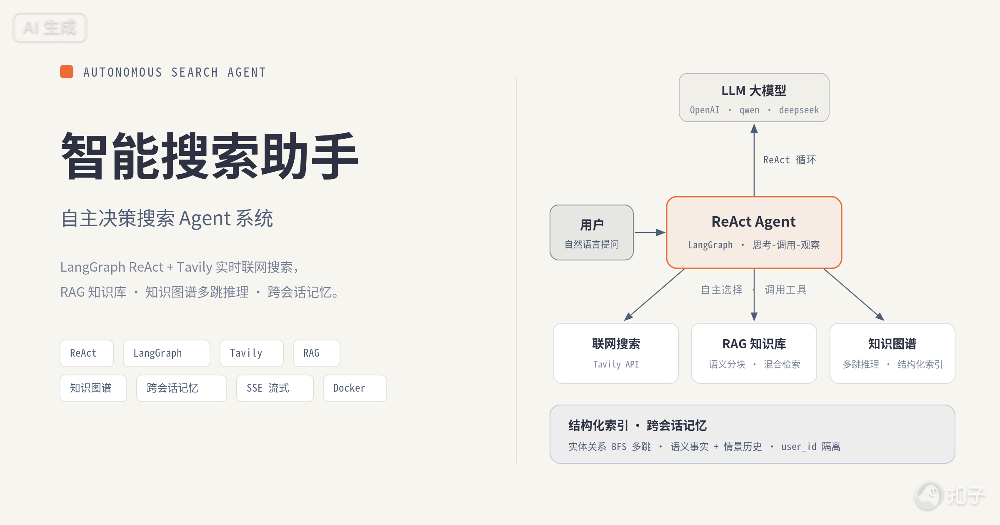

---
AIGC:
    Label: "1"
    ContentProducer: 001191110102MACQD9K64018705
    ProduceID: 1219778990063427_0-data_volume/7654561358939390246-files/所有对话/主对话/qa-sysyywe/qa-sysyywe-feat-structured-index/README.md
    ReservedCode1: ""
    ContentPropagator: 001191110102MACQD9K64028705
    PropagateID: 1219778990063427#1794556780650
    ReservedCode2: ""
---
# 智能搜索助手

**一个会自己决定「要不要搜、搜几次、什么时候停」的问答服务。后端 LangGraph 的 ReAct Agent，前端 Next.js 16，对外只有一条 SSE 流式接口，本地一条命令就能跑起来。**

[](#license) [](requirements.txt) [](frontend/package.json) [](agent/graph.py) [](tests) [](evals)

**220 个测试函数 · 6 套评测套件 · E2E 打分 + 回归门禁 · 1 条 SSE 接口**

> 它不是「搜 5 条 → 拼 prompt → 让模型总结」的 RAG demo。搜索时机由 Agent 自己判断，长文在子 Agent 的独立上下文里读，没有证据支撑的结论在句末打 `[低置信度]`。

**目录：** [为什么](#为什么不是又一个-rag-demo) · [链路](#一次提问的链路) · [检索](#检索流水线) · [记忆](#记忆) · [图谱](#结构化索引与知识图谱) · [缓存](#语义缓存) · [接口](#接口) · [工具](#agent-工具) · [配置](#配置) · [运行](#本地跑起来) · [评测](#评测与数据飞轮) · [部署](#部署) · [可观测](#可观测性) · [结构](#项目结构) · [已知问题](#已知问题)

<p align="center">
  
</p>

## 为什么不是又一个 RAG Demo

常见的搜索问答是这样跑的：改写 query → 固定搜 5 条 → 摘要拼进 prompt → 模型作答。这套流程上线之后会撞上三个问题，这个项目把它们拆开处理。

| 问题 | 常见做法 | 这里的做法 |
|---|---|---|
| 上下文被网页正文撑爆 | 6 个页面的正文全塞进 prompt，十几 KB 起步 | 子 Agent 在自己的上下文里读完，只交回几百字摘要 |
| 搜索时机写死 | 不管问题难易，固定搜一次 | Agent 看工具列表自己决定下一步，`recursion_limit` 是 40 |
| 搜不到就开始编 | 检索返回空，模型照样给一段像答案的话 | 句末打 `[低置信度]`，`done` 事件里带 `confidence` |

**上下文被撑爆的代价。** 一次检索把 6 个页面的正文全塞进 prompt，十几 KB 起步。聊到第五轮，模型已经记不清第一轮查过什么。

**该多搜的时候不搜，该停的时候不停。** 硬编码的流水线分不出「今天北京天气」和「对比三款两千元档手机」，前者一次搜索就够，后者不拆成三个子问题根本查不全。

**搜不到就开始编。** 检索返回空的时候，模型照样能写出一段看起来很像答案的话，用户无从判断。

接下来，一次提问从进来到出去，中间到底发生了什么。

## 一次提问的链路

1. **输入护栏。** 正则匹配提示注入特征（覆盖系统指令、角色扮演越狱、索要 system prompt、base64 绕过、越权请求），命中直接拒绝，不进入模型。
2. **记忆召回。** 按 `user_id` 取出长期事实和相关的历史对话片段，渲染成 system 前缀注入。
3. **ReAct 循环。** 模型看工具列表自己决定下一步。工具返回的末尾会追加一行状态栏（`当前工具调用统计 -> search: 2 次`），调用超过 10 次时附一句收敛提醒。
4. **检索。** `search` 工具内部是一整条流水线，见下一节。
5. **复杂任务分流。** 涉及多实体对比或长文阅读时，模型会调 `spawn_search_worker`，子 Agent 查完只把摘要交回来。
6. **语义缓存。** 新会话首轮提问时先查一次，命中就跳过整个 Agent 循环。
7. **流式输出。** SSE 逐 token 推给前端，中间穿插检索进度和来源。

第 3 步和第 4 步是耗时大头，下面拆开看。

## 检索流水线

`search` 工具不是简单调一次搜索 API：

```text
改写 query（LLM，输出 JSON：主查询 + 最多 2 个子查询 + 意图类型）
   ↓ 最多 3 个查询并发请求 Tavily，每个取 5 条
URL 去重（滑窗）
   ↓ 取前 6 个 URL
流式抓正文（trafilatura 解析，总预算 6 秒，谁先返回先切谁）
   ↓
切片（600 字，重叠 100）
   ↓
TF-IDF 余弦重排，取前 5 段
   ↓
包成 <context_pool> 里的若干 <chunk>，附来源 URL
```

每一档参数的来由：

| 环节 | 参数 | 说明 |
|---|---|---|
| 查询改写 | 主查询 + 最多 2 个子查询 | LLM 输出 JSON，同时给意图类型，决定后续要不要走子 Agent |
| 并发检索 | 最多 3 个查询 × 5 条 | Tavily，三个查询一起发 |
| 正文抓取 | 前 6 个 URL，总预算 6 秒 | 异步生成器，先解析完的先切片 |
| 切片 | 600 字，重叠 100 | 按段落边界切，尽量不切断句子 |
| 重排 | TF-IDF 余弦，取前 5 段 | scikit-learn，不上 embedding 模型 |

几个实现上的选择：

- **抓取用异步生成器，不用 `asyncio.gather`。** 等 6 个网页全部返回再处理，慢的那个会把整体拖到十几秒；改成谁先解析完就先切片进候选池，6 秒到了直接收尾。
- **重排用 TF-IDF，不上 embedding。** 切片和 query 都是同一批文本，字面重合度已经够用，省掉一次模型下载和一次推理。
- **抓取全失败时降级用搜索 API 的 snippet**，不返回空结果。
- **`read_tool_output` 基本不再触发。** 早期版本把超长结果落盘、让模型自己去读，现在流水线直接产出精炼上下文，这个工具保留只是为了兼容旧路径。

检索只解决「这一次搜什么」，跨轮次的部分交给记忆。

## 记忆

`user_id` 贯穿两套存储，都可以为空（为空时静默降级，不落盘）：

| 类型 | 内容 | 用法 |
|---|---|---|
| 语义记忆 `FactStore` | 从用户发言里抽出来的长期事实 | 每轮召回，渲染成「关于该用户的长期记忆」 |
| 情景记忆 `EpisodicStore` | 跨会话的对话片段 | 按当前 query 相似度取前 5 条 |
| 会话历史 `UserStore` | 单会话内的完整消息 | 支持内存 / Redis 两种后端，`SESSION_BACKEND=redis` 切换 |

事实抽取默认走规则（正则匹配「我叫…」「我在…工作」这类句式），不调 LLM。想用 LLM 兜底需要显式传 `extract_llm=True`。

`/api/chat/stream` 的请求参数里带 `enable_memory`，关掉就跳过整段召回，只留当轮上下文。调 prompt、做 A/B、复现「模型为什么突然记错」的时候用得上。

`memory/tdai_adapter.py` 是对 TencentDB-Agent-Memory 的适配层，`TDAI_ENABLED=false` 时整条路径不生效，属于可选侧车。

记忆存的是「说过什么」，图谱存的是「谁和谁有关系」，两者在 `rag/` 里汇合。

## 结构化索引与知识图谱

`rag/` 下是三层，职责不重叠：

| 层 | 做什么 | 存储 |
|---|---|---|
| `KnowledgeBase` | 语义分块 + 混合检索（哈希特征向量 + 关键词匹配），带 `timestamp` 元数据做时效加权 | 默认 JSON，`RAG_BACKEND=chroma` 切 ChromaDB |
| `KnowledgeGraph` | 实体 + 关系的邻接表，实体 id 是 `sha256(规范化 name + type)`，同名同型跨文档合并，`resolve_entity` 消歧，`traverse` 做 BFS 多跳 | JSON，纯 Python |
| `StructuredIndex` | 胶水层。写入走「分块 → LLM 抽取实体关系 → 建图 → 回填 `entity_ids`」，查询把 KB 命中的单元和它关联的实体、多跳路径一起返回 | 复用上面两者 |

抽取失败就退化成纯语义检索，不阻断写入。

`graph_search` 工具调的就是这一层，返回结果里带 `↳ 关联实体` 和多跳路径文本。适合家族关系、案件关联这类需要精确消歧的场景，不适合开放域问答。

写入走 `POST /api/knowledge/upload`：上传文档后跑一遍「分块 → 抽取实体关系 → 建图 → 回填 `entity_ids`」。抽取失败的文档照样入库，只是退化成纯语义检索。

图谱和知识库都在本地，缓存却在 Redis 里，这是另一条链路。

## 语义缓存

Redis 存历史问答对，key 是 query 的 md5，value 里带一个 256 维字符 n-gram 哈希向量。查询时遍历所有 key 算余弦相似度，超过 0.95 就返回缓存答案。

命中后按 5 个字符一块往外吐，做出打字机效果。默认 TTL 一天，命中时续期。

只在新会话首轮生效，避免把上一轮的答案套到这一轮的上下文里。

规模上去之后这段要改：现在是 `KEYS semantic_cache:*` 全量扫，几千条以内还行，再多就该换 Redis Search 或者真正的向量库。

前面讲的是内部怎么跑，下面是对外的接口。

## 接口

| 端点 | 方法 | 说明 |
|---|---|---|
| `/api/chat/stream` | POST | SSE 流式问答，可透传模型和 MCP 配置 |
| `/api/feedback` | POST | 提交 👍/👎 反馈，落 Redis，供自动构造 Bad Case |
| `/api/feedback/recent` | GET | 获取最近的反馈（`?only_bad=true` 只看点踩） |
| `/api/sessions?user_id=` | GET | 用户会话列表 |
| `/api/session/{id}` | GET | 会话历史（内存 → 持久化 → 兜底提示，三级查找） |
| `/api/session/{id}` | DELETE | 删除会话 |
| `/api/memory/{user_id}` | GET | 查看长期事实和情景片段 |
| `/api/memory/{user_id}` | DELETE | 清空该用户记忆 |
| `/api/memory/tdai/{user_id}` | GET | TDAI 侧车记忆观测（未启用时返回说明） |
| `/api/knowledge/upload` | POST | 上传文档进知识库，走结构化索引写入 |
| `/api/config/defaults` | GET | 后端默认模型与检索参数 |
| `/api/health` | GET | 健康检查 + 当前活跃会话数 |
| `/api/metrics` | GET | Prometheus 文本格式；`?format=json` / `?format=availability` 换格式 |

`/api/feedback` 是数据飞轮的入口，对应评测一节里的 `feedback_to_dataset.py`。

`POST /api/chat/stream` 的请求体：

```json
{
  "query": "今天有什么值得关注的科技新闻",
  "session_id": "s_1730000000_ab12cd",
  "user_id": "u_alice",
  "model": "qwen-plus",
  "llm_provider": "qwen",
  "mcp_config": {}
}
```

`model` / `llm_provider` / `api_base` / `api_key` / `mcp_config` 都是可选的。传了就会现场实例化一个新的 `ChatOpenAI` 和 `create_react_agent`，不碰全局单例，所以并发请求之间不会互相覆盖配置。

<details>
<summary><b>SSE 事件表</b></summary>

```text
event: progress        {"node":"search|generate|fallback|cache","message":"正在深度检索并精读网页: ..."}
event: token           {"text":"逐 token 文本"}
event: reset_tokens    {}                    # 开始检索时清空已输出的正文
event: sources         {"sources":[{url,title,snippet}]}
event: done            {confidence,latency_ms,tokens_used,is_fallback}
event: error           {message,code}
```

`reset_tokens` 是为了处理一种情况：模型先输出了一段「我这就去查」，然后才调搜索。前端收到这个事件就把已经渲染的正文清掉，避免用户看到模型的自言自语。

</details>

接口之下，模型能调的是这八个工具。

## Agent 工具

| 工具 | 作用 |
|---|---|
| `spawn_search_worker` | 委派子 Agent 独立检索并提炼，只回摘要 |
| `search` | 联网深度检索，内部走完整流水线，返回 `<context_pool>` |
| `knowledge_search` | 本地知识库检索，支持时效过滤 |
| `graph_search` | 知识图谱检索，实体消歧 + 多跳路径 |
| `history_search` | 检索该用户过往会话 |
| `read_tool_output` | 读取落盘的超长工具输出（安全限制在 `/tmp/tool_outputs/`） |
| `calculator` | AST 白名单算术求值 |
| `current_time` | 当前 UTC 时间 |

另外支持 MCP 工具动态接入：启动时通过 stdio 连接本地 `mcp_server.py`（目前是个天气查询的占位实现），前端也可以在请求里带 `mcp_config` 指定其他 MCP Server，工具列表按配置的 md5 缓存。

工具齐了，接下来是让它跑起来需要的配置。

## 配置

复制 `.env.example` 为 `.env`，至少要填 `LLM_API_KEY` 和 `TAVILY_API_KEY`。

<details>
<summary><b>环境变量表</b></summary>

| 变量 | 默认 | 说明 |
|---|---|---|
| `LLM_PROVIDER` | 空 | `openai` / `qwen` / `deepseek`，会覆盖 base URL 和默认模型 |
| `LLM_API_BASE` / `LLM_API_KEY` / `LLM_MODEL` | — | 不填 provider 时直连 |
| `TAVILY_API_KEY` | — | 检索必需 |
| `SESSION_BACKEND` | `memory` | 改 `redis` 走 Redis 会话存储 |
| `REDIS_HOST` / `REDIS_PORT` / `REDIS_DB` | `localhost` / `6379` / `0` | 语义缓存也依赖这个连接 |
| `RAG_BACKEND` | `json` | 改 `chroma` 启用 ChromaDB |
| `RAG_USE_TRANSFORMERS` | `0` | 改 `1` 且模型已缓存时启用 sentence-transformers |
| `TDAI_ENABLED` | `false` | 开启外部记忆侧车 |
| `CORS_ORIGINS` | `localhost:3000,3001` | 逗号分隔 |

</details>

其余参数（搜索深度、Top-K、历史轮数、重试、限流）在 `config.py` 的 `AgentConfig` 里，都有默认值，改代码或者用同名环境变量覆盖都可以。

## 本地跑起来

需要 Python 3.11+ 和 Node 20+。后端：

```bash
pip install -r requirements.txt
cp .env.example .env      # 填 LLM_API_KEY 和 TAVILY_API_KEY
uvicorn server:app --reload --port 8000
```

前端：

```bash
cd frontend
npm ci
npm run dev               # http://localhost:3000
```

前端的 `/api/chat/stream` 是一条透传代理，服务端转发到 `BACKEND_URL`（默认 `http://localhost:8000`），浏览器不用处理 CORS。

语义缓存和 Redis 会话存储需要本地有 Redis；没有的话把 `SESSION_BACKEND` 留成 `memory`，缓存相关代码会打日志然后跳过，不影响主流程。

<details>
<summary><b>Streamlit 调试界面（可选）</b></summary>

`app.py` 是 Streamlit 版界面，`streamlit run app.py` 可以直接用，适合调试，功能比 Next 前端少。

</details>

跑起来之后，怎么判断改动没有把东西弄坏。

## 评测与数据飞轮

三件事：跑分、卡红线、把线上坏例变回测试集。

```bash
python -m evals --kind golden_e2e --concurrency 3   # 黑盒并发评测 + LLM Judge 打分
python -m evals.gate --save-baseline                # 保存当前结果作为红线
python -m evals.gate                                # 门禁对比：退化超 5% 或 Veto 增加，退出码 1
```

| 机制 | 内容 | 说明 |
|---|---|---|
| `golden_e2e` | 真实 Agent 调用 + 大模型裁判 | 剔除 `time_sensitive` 样本，判 Fact / Grounded / Citation 三项 |
| `evals/gate.py` | 对比基线并拦截 | 供 CI 门禁使用，强制防止模型退化 |
| 数据飞轮 | 反馈收集 → 测试集回流 | `feedback_to_dataset.py` 把线上点踩记录自动转成 Golden 题 |

确定性套件：

```bash
python -m evals                          # 全跑，出 console + JSON 报告
python -m evals --kind offline_regression
python -m evals --list
python -m evals --html -o report.json    # 额外输出 HTML
python -m evals --probe                  # 在线监控：真去打运行中的后端
python -m evals --judge                  # 检索质量：启用 LLM-as-judge
```

| 套件 | 内容 | 门禁 |
|---|---|---|
| `offline_regression` | pytest 全量 + 黄金数据集 | 0 failed / 0 error，黄金集 0 失败 |
| `fault_injection` | 搜索超时、LLM 报错、存储损坏、空结果 | 全部降级路径可用 |
| `security_audit` | 提示注入语料 + 脱敏用例 | 漏检 0，误报 0 |
| `online_monitoring` | 监控栈配置自检，`--probe` 时实测 SLA | 各窗口可用性 ≥ 95% |
| `quality` | 检索 hit@1、图谱多跳推理 | hit@1 = 100%，图谱全过 |
| `memory` | 记忆模块端到端 | 全过 |

退出码非 0 就是门禁失败，CI 直接挂。`.github/workflows/ci.yml` 里跑的是 5 个确定性套件（不依赖外网），`golden_e2e` 和 `evals.gate` 由主分支单独触发，不占每次提交；依赖用 `uv` 装，绕开 pip 依赖解析过深的问题。前端另有 `tsc --noEmit` + ESLint。

## 部署

**Docker Compose**，四个服务：后端 + 前端 + Prometheus + Grafana。

```bash
docker compose up -d --build
```

| 服务 | 端口 | 备注 |
|---|---|---|
| 后端 | 8000 | FastAPI + SSE |
| 前端 | 3001 | Next.js |
| Prometheus | 9090 | 每 15 秒抓一次 `/api/metrics` |
| Grafana | 3002 | 默认 admin/admin |

<details>
<summary><b>Kubernetes 清单</b></summary>

- `k8s/deployments/` 后端 3 副本，`maxUnavailable: 0` 滚动更新
- `k8s/hpa/` 2–10 副本，CPU 70% / 内存 80% 触发扩容，缩容有 5 分钟稳定窗口
- `k8s/ingress/` `/api/` 走后端、`/` 走前端，SSE 关了 `proxy-buffering`，读写超时 300 秒
- `k8s/redis/` 会话与缓存
- `k8s/quotas/` PVC

Windows 下有一键脚本 `deploy-all.ps1` / `fix-and-start.ps1`。

</details>

## 可观测性

- **指标。** Prometheus 每 15 秒抓 `/api/metrics`：请求量、延迟分布、SSE 流状态、搜索成功率、token 消耗、错误计数、活跃会话、图谱规模、图检索延迟。
- **告警。** 六条规则：错误率、延迟、服务存活、搜索失败率、token 消耗、抽取失败率。
- **链路追踪。** OTel 埋点覆盖 FastAPI / httpx / LangChain，配了 `LANGFUSE_*` 就导出到 Langfuse，没配就自动关闭。
- **坏例回流。** SSE 流结束时按情况往 span 上打 `reviewer_revise` / `fallback` / `error` 标签；`scripts/reflow_evals.py` 从 Langfuse 拉最近 7 天的慢请求和报错 trace，脱敏后写成 `evals/datasets/reflow_cases.jsonl`，作为回归样本。

## 项目结构

```text
qa-sysyywe/
├── agent/          # ReAct 主循环、工具定义、SSE 编排
├── tools/          # 检索流水线、网页精读、TF-IDF 重排
├── rag/            # 知识库、知识图谱、结构化索引
├── memory/         # 事实 / 情景 / 会话存储、TDAI 适配
├── utils/          # 护栏、指标、上下文压缩、语义缓存、连接池
├── evals/          # 确定性套件 + golden_e2e + gate 门禁
├── tests/          # 220 个测试函数
├── k8s/            # 部署清单
├── monitoring/     # Prometheus 配置与 Grafana 面板
├── frontend/       # Next.js 16 + React 19
├── mcp_server.py   # 本地 MCP 工具示例
├── server.py       # FastAPI 入口
└── app.py          # Streamlit 调试界面
```

## 已知问题

写在这里，免得下次又踩：

| 问题 | 影响 | 现状 |
|---|---|---|
| Reviewer 只有事件位，没有实现 | `server.py` 和前端都留着 `event: revise` 分支，后端从没发过这个事件 | 当初想做 Proposer-Reviewer 双阶段核查，最后落地的是 system prompt 里的置信度自检。要用得从头写 |
| 缓存命中的 `latency_ms` 写死 10.0 | 不是实测值，上报 Langfuse 会污染延迟统计 | 未修 |
| 语义缓存全量扫 key | 几千条以内还行，再往上延迟线性增长 | 规模上来要换 Redis Search 或向量库 |
| k8s 里 `/app/data` 是 `emptyDir` | 多副本之间不共享，Pod 重启后知识库和图谱的 JSON 就没了 | 要持久化得换 PVC 或把存储外置 |
| `docker-compose.yml` 引用的 `Dockerfile.backend` / `Dockerfile.frontend` 不存在 | 实际文件是 `Dockerfile` 和 `frontend/Dockerfile`，直接 `docker compose up` 会在构建阶段失败 | 先改名或改 compose 里的路径 |
| 图谱和知识库都是进程内单例 + JSON 文件 | 没有并发写保护，多 worker 部署下别指望数据一致 | 单进程可用 |

## License

MIT

---


