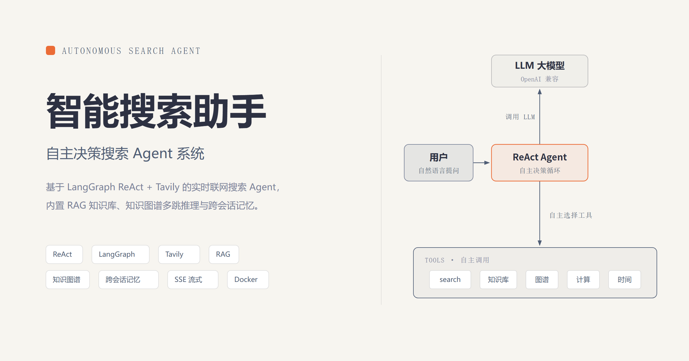
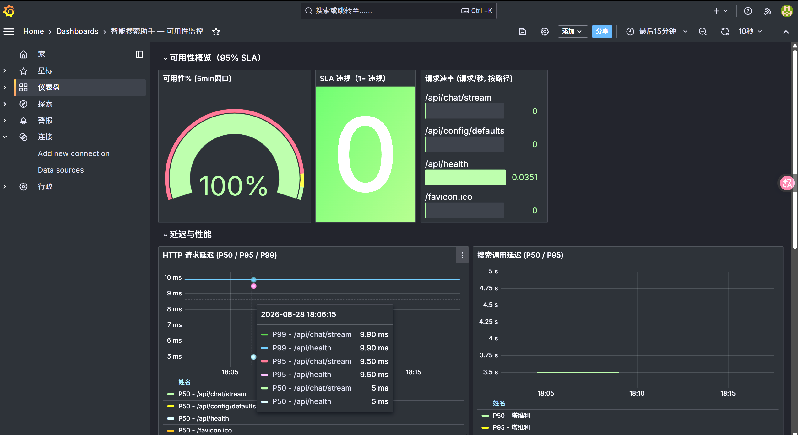

<p align="center">
  
</p>

<!-- 封面横幅由 banner.html（diagram-design 源文件）渲染，改封面请编辑 banner.html 后用 headless Chrome 重新导出 banner.png -->

<p align="center">
  <a href="https://github.com/231dff/qa-sysyywe"></a>
  <a href="LICENSE"></a>
  
  
  
  
  
  
  
  
</p>

<br>

# 🔍 智能搜索助手 — 自主决策搜索 Agent 系统

## 🖼️ 界面预览

**Grafana 监控面板**（可用性 SLA 可视化）：

<p align="center">
  
</p>


基于 **LangGraph (ReAct)** + **Tavily API** + **FastAPI** + **Next.js 16** 构建的自主决策搜索 Agent。支持 OpenAI 兼容的 LLM（OpenAI / 阿里云百炼 DashScope / DeepSeek 等多平台），并内置**结构化索引（知识图谱多跳推理）**与**跨会话记忆系统（语义 + 情景）**。

## ✨ 核心特性

- **ReAct 自主决策**: LLM 根据工具描述按需加载工具、自主决定「是否搜索 / 搜索几次 / 何时停止」，不再硬编码流水线
- **多平台适配**: `LLM_PROVIDER=openai|qwen|deepseek` 一键切换，自动处理 `response_format` / embedding 等平台差异
- **实时搜索**: Tavily API 联网搜索，突破 LLM 知识时效限制
- **RAG 知识库**: 本地知识库检索（语义分块 + 混合检索 + 时效治理），纯 Python 持久化零冲突，可选 ChromaDB / 本地 embedding
- **知识图谱 + 多跳推理**: LLM 实体/关系抽取 → 稳定哈希消歧 → BFS 多跳遍历，支撑医疗问诊、法律案件、家族关系等垂直场景的「A→关系→B」精确推导
- **跨会话记忆系统**: 语义记忆（长期事实）+ 情景记忆（相关历史召回）+ 编排层，user_id 隔离持久化，Agent 无需用户重复交代
- **护栏与安全**: 提示注入检测、敏感信息脱敏、工具权限白名单、日志脱敏
- **上下文压缩**: 分层历史压缩 + 前缀稳定化（利于 prompt cache / KV cache），降低延迟与 token 开销
- **辅助工具**: 安全计算器（AST 白名单）、当前时间、知识库检索、图谱检索等按需加载
- **SSE 流式输出**: LLM 答案逐 Token 推送到前端
- **多层容错**: 指数退避重试 + LLM 降级回答，异常期可用性 **95%+**
- **多轮对话**: 基于会话 ID 的上下文缓存 + 分层压缩 + 跨进程持久化恢复
- **可观测性栈**: Prometheus 指标采集 + Grafana 可视化仪表盘 + 告警规则
- **企业级评测框架**: 6 类评测套件（离线回归 / 故障注入 / 安全审计 / 在线监控 / 检索质量 / 记忆）+ 门禁机制，一条命令驱动，供 CI 判定
- **企业级 UI**: 极简灰阶设计，去 AI 味，专业排版

## 🏗️ 架构

```
┌──────────────────┐     SSE Stream       ┌──────────────┐       HTTP         ┌────────────────┐
│ Next.js 16 前端   │ ◄─────────────────── │  FastAPI 后端  │ ──────────────────► │ LLM API        │
│ (port 3001)       │   event: progress    │  (port 8000)   │   streaming POST   │ (OpenAI 兼容)   │
│                   │   event: token       │               │                    │                │
│ React 19 + TS     │   event: sources     │  LangGraph     │ ──────────────────► │ Tavily Search   │
│ Tailwind CSS 4    │   event: done        │  ReAct Agent   │   Search API       │ API             │
│ App Router        │   event: error       │               │                    │                │
├──────────────────┤                       ├───────────────┤                    └────────────────┘
│ Streamlit 面板    │                       │ 全局 httpx     │
│ (port 8501)       │                       │ 连接池复用     │
│ 开发调试用         │                       │               │
└──────────────────┘                       ├───────────────┤
                                           │ /api/metrics   │ ◄── Prometheus 抓取 (每 15s)
                                           │ Prometheus 指标 │
┌──────────────────┐                       └───────┬───────┘
│ Grafana 仪表盘    │ ◄─── PromQL ──── ┌────────────┴───────┐
│ (port 3002)       │                  │ Prometheus          │
│ 可用性 SLA 监控   │                  │ (port 9090)         │
└──────────────────┘                  │ 抓取 + 告警          │
                                      └─────────────────────┘
```

### 记忆系统（三块地基，user_id 贯穿）

```
  用户发言 ──► MemoryManager.remember
                 ├─► 情景记忆 EpisodicStore   （跨会话相关历史对话，关键词重叠 + 时间衰减召回）
                 └─► 语义记忆 FactStore       （用户发言 → 规则/LLM 抽取长期事实，按置信度 upsert）

  新一轮提问 ──► MemoryManager.recall(user_id, query)
                 └─► 渲染「长期事实 + 相关历史片段」→ 注入 LLM 为 system 前缀
```

### 结构化索引（知识图谱多跳推理）

```
  KnowledgeBase（语义分块 + 向量检索）
        └─► extractor（LLM 实体/关系抽取，失败静默降级）
              └─► KnowledgeGraph（稳定哈希消歧 + BFS 多跳遍历）
                    └─► 回填 entity_ids 到 KnowledgeBase 单元
```

### Agent 工作流（ReAct 循环）

```
                ┌─────────────────────────────────────────────┐
                │              LangGraph ReAct 循环             │
                │                                             │
  用户输入 ────► │  模型思考 ──► 需要工具？ ──是──► 调用工具      │
                │      ▲            │                │         │
                │      │           否              观察结果    │
                │      │            │                │         │
                │      └──────── 直接作答 ◄───────────┘         │
                │                                             │
                │  可用工具: search / knowledge_search /        │
                │            graph_search / calculator /       │
                │            current_time                      │
                └─────────────────────────────────────────────┘
                                  │
                                  ▼
                           最终答案 + 来源
```

模型根据工具 JSON Schema 描述**自主决策**调用时机与次数，`tools_condition` 自动路由驱动循环，信息充分即停止。

## 📁 项目结构

```
qa/
├── agent/                          # Agent 核心模块
│   ├── __init__.py                 # 模块入口
│   ├── graph.py                    # SearchAgent 薄封装（委托 ReactAgent，会话 + 记忆编排）
│   ├── react.py                    # ReactAgent：create_react_agent + 系统提示 + 结果提取
│   ├── tools.py                    # ReAct 工具集：search / knowledge_search / graph_search / calculator / current_time
│   ├── models.py                   # Pydantic 数据模型 + AgentState TypedDict
│   └── streaming.py                # SSE 流式桥接（astream_events v2 → SSE 事件）
├── tools/                          # 工具注册中心（底层实现）
│   ├── __init__.py                 # 工具模块
│   └── registry.py                 # tavily_search / rewrite_query / score_relevance / fallback_answer + 组合流水线
├── rag/                            # RAG 知识库 + 结构化索引
│   ├── __init__.py                 # KnowledgeBase：语义分块 + 混合检索 + 时效治理（纯 Python 持久化，可选 ChromaDB）
│   ├── extractor.py                # LLM 实体/关系抽取（失败静默降级为空）
│   ├── graph.py                    # KnowledgeGraph：稳定哈希消歧 + BFS 多跳推理
│   └── structured.py               # StructuredIndex：分块→抽取→建图→回填 全链路编排
├── memory/                         # 记忆系统
│   ├── __init__.py                 # 记忆模块入口
│   ├── session_store.py            # 会话缓存 (TTL 过期)
│   ├── user_store.py               # 按 user_id 隔离的会话持久化（跨进程/重启恢复）
│   ├── fact_store.py               # 语义记忆：长期事实存储（置信度 upsert）
│   ├── episodic_store.py           # 情景记忆：跨会话相关历史检索（关键词重叠 + 时间衰减）
│   ├── fact_extractor.py           # 长期事实抽取（规则优先 + 可选 LLM 兜底）
│   └── memory_manager.py           # 记忆编排层：recall / remember，user_id 贯穿
├── utils/                          # 工具函数
│   ├── __init__.py                 # 工具函数模块
│   ├── helpers.py                  # URL 去重, Token 计数, 限流, 上下文裁剪
│   ├── http_client.py              # 全局共享 HTTP 客户端 (连接池复用)
│   ├── metrics.py                  # Prometheus 指标 + 滑动窗口可用性统计 (95% SLA) + 图谱指标
│   ├── guardrails.py               # 护栏：提示注入检测 / 敏感脱敏 / 工具白名单
│   └── context.py                  # 上下文压缩：分层历史 + 前缀稳定化
├── monitoring/                     # 可观测性栈
│   ├── prometheus/
│   │   ├── prometheus.yml          # Prometheus 配置 (15s 抓取间隔)
│   │   └── alerts.yml              # 告警规则 (高错误率/高延迟/服务宕机)
│   └── grafana/
│       ├── dashboards/
│       │   ├── availability.json   # 可用性监控 Dashboard
│       │   └── dashboard.yml       # Dashboard 自动加载配置
│       └── datasources/
│           └── prometheus.yml      # Prometheus 数据源
├── evals/                          # 企业级评测框架
│   ├── __init__.py                 # 评测包（导出核心 API）
│   ├── __main__.py                 # 统一入口：python -m evals
│   ├── core.py                     # 框架底座：Suite 注册表 / 门禁 / JSON+HTML 报告
│   ├── offline.py                  # 离线回归套件（pytest + 黄金行为数据集）
│   ├── fault_injection.py          # 故障注入套件（LLM/搜索/存储/流水线降级）
│   ├── security_audit.py           # 安全审计套件（护栏有效性对抗）
│   ├── online.py                   # 在线监控套件（监控栈自检 + 实测 SLA 探测）
│   ├── quality.py                  # 检索质量套件（RAG 命中率 + 图谱多跳 + 可选 judge）
│   └── memory_suite.py             # 记忆套件（语义 + 情景 + 编排端到端）
├── tests/                          # 测试 (203 条)
│   ├── __init__.py                 # 测试包
│   ├── test_core.py                # 单元测试 (去重/Token/限流/会话/模型)
│   ├── test_registry.py            # 工具注册中心测试 (搜索/改写/打分/降级/流水线)
│   ├── test_graph.py               # ReactAgent + SearchAgent 类测试
│   ├── test_config.py              # 配置加载 + 单例 + 多平台 provider
│   ├── test_production.py          # 护栏 / 上下文压缩 / provider 生产级测试
│   ├── test_structured.py          # 结构化索引：知识图谱 + 多跳推理 + 抽取
│   ├── test_episodic_store.py      # 情景记忆存储测试
│   ├── test_fact_store.py          # 语义记忆（长期事实）存储测试
│   ├── test_fact_extractor.py      # 事实抽取器测试（规则 + LLM 兜底）
│   ├── test_user_store.py          # 用户会话持久化测试
│   ├── test_memory_manager.py      # 记忆编排层测试
│   └── test_e2e.py                 # 端到端 ReAct 流水线 + 会话测试
├── frontend/                       # Next.js 16 前端
│   ├── app/
│   │   ├── layout.tsx              # 根布局 (Geist 字体)
│   │   ├── page.tsx                # 应用入口页
│   │   ├── globals.css             # 全局样式 (Tailwind CSS 4)
│   │   └── api/chat/stream/
│   │       └── route.ts            # API 代理 (Next.js → FastAPI rewrite)
│   ├── src/
│   │   ├── components/
│   │   │   ├── ChatArea.tsx         # 聊天区域 (消息列表 + 输入框)
│   │   │   ├── ChatInput.tsx        # 消息输入框
│   │   │   ├── MessageBubble.tsx    # 消息气泡 (Markdown 渲染)
│   │   │   ├── MarkdownContent.tsx  # Markdown 渲染 + 流式光标
│   │   │   ├── Sidebar.tsx          # 侧边栏 (会话管理)
│   │   │   ├── SourcesPanel.tsx     # 来源面板
│   │   │   ├── MetaBar.tsx          # 元信息栏 (延迟/Token/置信度)
│   │   │   └── StreamingToken.tsx   # 流式 Token 光标
│   │   ├── hooks/
│   │   │   └── useSSE.ts            # SSE 流式连接 Hook
│   │   ├── lib/
│   │   │   ├── types.ts             # TypeScript 类型定义
│   │   │   └── api.ts               # API 调用封装
│   │   └── providers/
│   │       └── ChatProvider.tsx      # 聊天状态管理 (React Context)
│   ├── next.config.ts               # Next.js 配置 (rewrites 代理 + standalone 输出)
│   ├── package.json                 # 依赖: Next.js 16.2, React 19.2, Tailwind CSS 4
│   └── tsconfig.json                # TypeScript 配置
├── .github/
│   └── workflows/
│       └── ci.yml                   # CI 门禁：后端评测 + 覆盖率 + 前端类型检查/Lint
├── server.py                       # FastAPI 后端入口 (SSE + REST API + 记忆端点 + 生命周期管理)
├── app.py                           # Streamlit 开发调试面板
├── config.py                        # 全局配置 (pydantic-settings, 单例, 多平台 provider)
├── requirements.txt                 # Python 依赖
├── pytest.ini                       # pytest 配置 (testpaths + asyncio 模式)
├── Dockerfile.backend               # 后端 Docker 镜像 (python:3.12-slim)
├── Dockerfile.frontend              # 前端 Docker 镜像 (多阶段 node:22-alpine)
├── docker-compose.yml               # 一键部署编排 (bridge 网络 + 健康检查)
├── .dockerignore                    # Docker 忽略规则
├── .env                             # 环境变量 (LLM_API_KEY, TAVILY_API_KEY 等, git-ignored)
├── fix-and-start.ps1                # Windows 一键修复 & 启动脚本
└── README.md
```

## 🚀 快速开始

### 方式一: Docker Compose (推荐)

确保已安装 [Docker Desktop](https://www.docker.com/products/docker-desktop/) 或 Docker Engine 20.10+。

```bash
# 1. 配置 API 密钥
# 编辑 .env，填入真实的 API Key。

# ── LLM 配置 (OpenAI 兼容协议) ──
# 方式一：使用 provider 预设（推荐，自动处理平台差异）
#   LLM_PROVIDER=qwen      # openai | qwen | deepseek
#   LLM_API_KEY=sk-xxxx
#
# 方式二：显式指定 endpoint + model
# 阿里云百炼 DashScope (通义千问):
#   LLM_API_KEY=sk-xxxxxxxxxxxxxxxxxx
#   LLM_API_BASE=https://dashscope.aliyuncs.com/compatible-mode/v1
#   LLM_MODEL=qwen-plus
#
# OpenAI / DeepSeek / 其他兼容 API:
#   LLM_API_KEY=sk-your-key
#   LLM_API_BASE=https://api.openai.com/v1      # 或 https://api.deepseek.com/v1
#   LLM_MODEL=gpt-4o-mini                       # 或 deepseek-chat
#
# ── Tavily 搜索 API ──
# TAVILY_API_KEY=tvly-your-real-key

# 2. 构建并启动所有服务
docker compose up -d --build

# 3. 查看运行状态，确认所有服务 healthy
docker compose ps
```

启动后可访问以下地址：

| 服务 | 地址 | 说明 |
|------|------|------|
| 前端界面 | http://localhost:3001 | Next.js 16 生产模式 |
| FastAPI 文档 | http://localhost:8000/docs | Swagger UI |
| 健康检查 | http://localhost:8000/api/health | `{"status":"ok"}` |
| Prometheus 指标 | http://localhost:8000/api/metrics | 文本格式 (Prometheus 抓取) |
| Prometheus UI | http://localhost:9090 | 指标查询 + 告警状态 |
| Grafana 仪表盘 | http://localhost:3002 | 登录 admin/admin → 可用性监控面板 |

**容器端口映射**：

| 服务 | 容器内 | 宿主机 | 说明 |
|------|--------|--------|------|
| `search-backend` | 8000 | 8000 | FastAPI + uvicorn，SSE 流式聊天 |
| `search-frontend` | 3000 | 3001 | Next.js 16 生产模式 (standalone) |
| `search-prometheus` | 9090 | 9090 | 指标存储与查询 |
| `search-grafana` | 3000 | 3002 | 可视化仪表盘 (admin/admin) |

**常用操作**：

```bash
# 查看日志
docker compose logs -f backend          # 后端实时日志
docker compose logs -f frontend         # 前端实时日志
docker compose logs --tail=50 backend   # 后端最近 50 行

# 重启单个服务
docker compose restart backend

# 停止所有服务
docker compose down

# 完全重建（代码修改后）
docker compose down
docker compose build --no-cache
docker compose up -d

# 进入容器调试
docker exec -it search-backend bash
docker exec -it search-frontend sh
```

**镜像说明**：

| 文件 | 基础镜像 | 用途 |
|------|---------|------|
| `Dockerfile.backend` | `python:3.12-slim` | 安装 pip 依赖 → 启动 uvicorn |
| `Dockerfile.frontend` | 多阶段 `node:22-alpine` | `npm build` → 生产 runner 启动 `next start` |
| `docker-compose.yml` | — | 4 服务编排 + bridge 网络 + 健康检查 |

> **Windows 用户**: 如遇到 Docker Desktop gRPC 问题，可直接运行：
> ```powershell
> .\fix-and-start.ps1
> ```
> 该脚本自动检测 Docker 状态、清理旧资源、禁用 BuildKit 并启动服务。

### 方式二: 本地开发

#### 1. 安装依赖

```bash
pip install -r requirements.txt
```

#### 2. 配置 API 密钥

在 `.env` 文件中填入 API Key。本项目使用 **OpenAI 兼容协议**，支持多平台：

| LLM 提供商 | LLM_PROVIDER | LLM_API_BASE | 说明 |
|------------|-------------|--------------|------|
| OpenAI | `openai` | `https://api.openai.com/v1` | 全功能 |
| 阿里云百炼 DashScope (通义千问) | `qwen` | `https://dashscope.aliyuncs.com/compatible-mode/v1` | 全功能 |
| DeepSeek | `deepseek` | `https://api.deepseek.com/v1` | 无 `response_format` / embedding 端点，自动降级 |
| 其他兼容代理 (OneAPI/LiteLLM) | — | 自定义 | 手动指定 `LLM_API_BASE` + `LLM_MODEL` |

```bash
# 必填
LLM_PROVIDER=qwen          # 或 openai / deepseek
LLM_API_KEY=sk-xxx
TAVILY_API_KEY=tvly-xxx

# 可选 (以下为默认值)
LLM_MODEL=                 # 留空则用 provider 默认模型
LLM_TEMPERATURE=0.3
TAVILY_API_BASE=https://api.tavily.com
```

#### 3. 启动后端

```bash
# FastAPI 开发服务器 (port 8000)
uvicorn server:app --reload --port 8000

# 或直接运行
python server.py
```

#### 4. 启动前端 (二选一)

**Next.js 生产前端**:

```bash
cd frontend
npm install
npm run dev
# → http://localhost:3000
```

**Streamlit 开发面板**:

```bash
streamlit run app.py
# → http://localhost:8501
```

#### 5. 运行测试

```bash
# 全部测试 (203 条)
pytest tests/ -v

# 按模块运行
pytest tests/test_core.py -v         # 单元测试 (33 条)
pytest tests/test_registry.py -v     # 工具注册中心 (31 条)
pytest tests/test_structured.py -v   # 结构化索引 + 知识图谱 (25 条)
pytest tests/test_production.py -v   # 护栏/压缩/provider (25 条)
pytest tests/test_graph.py -v        # ReactAgent + SearchAgent (19 条)
pytest tests/test_config.py -v       # 配置加载 (18 条)
pytest tests/test_episodic_store.py -v # 情景记忆 (10 条)
pytest tests/test_e2e.py -v          # 端到端 (10 条)
pytest tests/test_fact_store.py -v   # 语义记忆 (9 条)
pytest tests/test_user_store.py -v   # 用户会话持久化 (8 条)
pytest tests/test_fact_extractor.py -v # 事实抽取 (8 条)
pytest tests/test_memory_manager.py -v # 记忆编排 (7 条)
```

## 📡 API 端点

| 端点 | 方法 | 描述 |
|------|------|------|
| `/api/chat/stream` | POST | SSE 流式聊天 (query, session_id, user_id, model, search_depth, top_k) |
| `/api/session/{id}` | GET | 获取会话历史 |
| `/api/session/{id}` | DELETE | 清除会话 |
| `/api/memory/{user_id}` | GET | 查看某用户的长期事实与情景记忆片段（观测/调试） |
| `/api/memory/{user_id}` | DELETE | 清空某用户的语义 + 情景记忆 |
| `/api/config/defaults` | GET | 获取默认配置 (model, search_depth, top_k, llm_api_base) |
| `/api/health` | GET | 健康检查 (status, active_sessions) |
| `/api/metrics` | GET | Prometheus 文本格式指标 |
| `/api/metrics?format=json` | GET | JSON 格式完整统计 (含可用性 + 指标快照) |
| `/api/metrics?format=availability` | GET | JSON 格式可用性统计 (仅 SLA) |

### SSE 事件类型

```
event: progress  → {"node":"search|generate|fallback","message":"..."}
event: token     → {"text":"逐token文本"}
event: sources   → {"sources":[{url,title,snippet}]}
event: done      → {confidence,latency_ms,tokens_used,is_fallback}
event: error     → {message,code}
```

> **说明**: ReAct 范式中不再有独立的 `rewrite` 节点（查询改写已并入模型推理），`progress.node` 以 `search` / `generate` / `fallback` 为主。

## 🛡️ 护栏与安全

项目内置生产级安全护栏（`utils/guardrails.py`）：

| 护栏 | 机制 | 触发行为 |
|------|------|----------|
| 提示注入检测 | 正则匹配「忽略指令/扮演角色/泄露系统提示/绕过限制」等模式 | 阻断请求，返回拒绝提示 |
| 敏感信息脱敏 | API Key / 邮箱 / 手机号 / 身份证 / AWS Key 模式匹配 | 日志与输出中自动掩码为 `***` |
| 工具调用护栏 | 工具白名单 + query 非空/长度校验 | 越权工具或非法参数被阻断 |
| 输出护栏 | 检测回答中的可疑指令回显 | 软标记供上游决定 |

## 🔧 Agent 工具集

ReAct Agent 按需加载以下工具（每个工具的 docstring 即 JSON Schema 边界契约）：

| 工具 | 类别 | 职责 |
|------|------|------|
| `search` | 实时检索 | Tavily 联网搜索，返回去重排序的摘要 + 结构化来源 |
| `knowledge_search` | 知识库 | 本地 RAG 检索（混合检索 + 时效过滤），返回知识片段 |
| `graph_search` | 知识图谱 | 结构化索引检索（关联实体 + 多跳推理路径），用于消歧与关系推导 |
| `calculator` | 计算 | 安全算术求值（AST 白名单，杜绝任意代码执行） |
| `current_time` | 时间 | 获取当前 UTC 时间 |

底层仍保留 `tools/registry.py` 中的 `tavily_search` / `rewrite_query` / `score_relevance` / `fallback_answer` 四个基础函数（供组合流水线与测试复用）。

## 🧠 记忆系统

解决「金鱼记忆」的三块地基，全部按 `user_id` 隔离、JSON 持久化、线程安全、空 `user_id` 安全降级：

| 模块 | 职责 | 检索/写入策略 |
|------|------|--------------|
| `UserStore` | 会话持久化 | 按 `user_id` 隔离，跨进程/重启恢复历史 |
| `FactStore`（语义记忆） | 长期事实 | 用户发言抽取 `{key, value, confidence}`，高置信度覆盖低置信度 |
| `EpisodicStore`（情景记忆） | 相关历史召回 | 关键词重叠打分 + 时间衰减（半衰期 30 天），相邻去重 |
| `MemoryManager`（编排层） | 统一召回/写回 | `recall` 渲染注入上下文；`remember` 落盘情景 + 抽取事实 |

事实抽取（`fact_extractor.py`）**规则优先、零依赖、离线确定**，可选 `use_llm=True` 走 LLM 兜底（失败静默降级为规则结果）。抽取类别：名字 / 居住城市 / 职业 / 技术栈 / 年龄 / 偏好。

## 🕸️ 结构化索引（知识图谱多跳推理）

面向「多跳推理 + 精确消歧」的垂直场景（医疗问诊、法律案件、家族/组织关系管理）：

| 组件 | 职责 |
|------|------|
| `rag/extractor.py` | LLM 实体/关系抽取（复用连接池 + 多平台降级，失败返回空不阻断） |
| `rag/graph.py` | `KnowledgeGraph`：稳定哈希 id 去重 + 别名消歧 + BFS 多跳遍历 |
| `rag/structured.py` | `StructuredIndex`：编排「分块 → 抽取 → 建图 → 回填」全链路 |

写入链路：`KnowledgeBase` 语义分块 → `extractor` 抽取实体/关系 → `KnowledgeGraph` 建图（实体先于关系）→ 回填 `entity_ids` 到知识库单元。查询链路：`search` 融合 KB 混合检索 + 关联实体 + 多跳路径。LLM 抽取失败时**静默退化为「仅自然语言记忆，无图谱」**，绝不阻断写入。

## 🧪 测试分层

项目采用**分层测试策略**，203 条测试全部 mock 外部 API，无需联网即可运行。

### 第一层: 单元测试 (`test_core.py` + `test_config.py` + `test_production.py` + 记忆存储) — 105 条

| 测试类 | 覆盖内容 |
|--------|----------|
| `TestURLDeduplicator` / `TestTokenCounting` / `TestContentFingerprint` / `TestRateLimiter` / `TestContextTrimming` / `TestFormatSearchContext` / `TestSessionStore` / `TestModels` | URL 去重、Token 计数、内容指纹、限流、上下文裁剪、会话存储、数据模型 |
| `TestAPIConfig` / `TestAgentConfig` / `TestSingletonFunctions` / `TestConfigCompleteness` / `TestProjectRoot` | 环境变量加载、SecretStr 安全、默认值、单例、字段完整性 |
| `TestPromptInjection` / `TestRedaction` / `TestToolGuardrail` | 提示注入检测、敏感脱敏、工具护栏 |
| `TestContextCompression` | 分层历史压缩、工具结果裁剪 |
| `TestProviderConfig` | 多平台 provider 预设与能力探测 |
| `TestFactStore` / `TestEpisodicStore` / `TestUserStore` / `TestFactExtractor` | 记忆系统三块地基：事实存储、情景存储、会话持久化、事实抽取 |

### 第二层: 集成测试 (`test_registry.py` + `test_graph.py` + `test_structured.py`) — 75 条

| 测试类 | 覆盖内容 |
|--------|----------|
| `TestTavilySearch` / `TestRewriteQuery` / `TestScoreRelevance` / `TestFallbackAnswer` / `TestSearchAndFilterPipeline` / `TestToolRegistryMetadata` | 工具函数与组合流水线（签名保持稳定） |
| `TestReactAgentHelpers` / `TestReactAgentRun` / `TestSearchAgentClass` / `TestReactSystemPrompt` | ReAct 循环、结果提取、会话管理、系统提示 |
| `TestKnowledgeGraph` / `TestExtractor` / `TestStructuredIndex` | 知识图谱消歧 + 多跳推理、实体抽取、结构化索引编排 |

### 第三层: 端到端测试 (`test_e2e.py` + `test_memory_manager.py`) — 17 条

| 测试类 | 覆盖路径 |
|--------|----------|
| `TestAgentPipelineE2E` | ReAct 正常流程 / 搜索失败→降级 / 生成失败→二次降级 / 多轮对话 / 历史裁剪 |
| `TestSessionManagement` | 自动 session + 清除会话 |
| `TestResultValidation` | 来源去重 + 延迟记录 + 流式输出契约 |
| `TestMemoryManager` | 记忆编排端到端：remember 抽取事实 + recall 渲染注入 + 隔离降级 |

## 📋 企业级评测框架

一条命令跑 6 类评测套件，输出 console + JSON + HTML 三种报告，并以**门禁结果决定退出码**（供 CI / pre-commit 判定）。

```bash
python -m evals                        # 跑全部 6 类套件
python -m evals --kind offline_regression   # 单跑离线回归
python -m evals --kind fault_injection      # 故障注入
python -m evals --kind security_audit       # 安全审计
python -m evals --kind online_monitoring    # 在线监控
python -m evals --kind quality              # 检索质量
python -m evals --kind memory               # 记忆
python -m evals --kind online_monitoring --probe   # 探测运行中后端实测 SLA
python -m evals --kind quality --judge      # 启用 LLM-as-judge 忠实度（需 key）
python -m evals --list                     # 列出已注册套件
python -m evals -o report.json             # 指定报告路径
python -m evals --html                     # 额外输出 HTML 报告
```

| 套件 | kind | 门禁口径 |
|------|------|----------|
| 离线回归 | `offline_regression` | pytest 0 failed/0 error 且黄金行为数据集 0 失败 |
| 故障注入 | `fault_injection` | 所有降级场景「优雅降级、绝不崩溃」 |
| 安全审计 | `security_audit` | 漏检(MISSED)=0 且误报(FALSE_POSITIVE)=0 |
| 在线监控 | `online_monitoring` | 监控栈配置完整（`--probe` 时升级为实测 95% SLA） |
| 检索质量 | `quality` | 强关键词检索 hit@1=100% 且图谱推理全过 |
| 记忆 | `memory` | 语义 + 情景 + 编排端到端全过 |

## 🛡️ 容错机制

| 故障类型 | 恢复策略 |
|----------|----------|
| 搜索 API 超时 | 异步指数退避重试 3 次 → LLM 降级回答 |
| 查询改写失败 (JSON 解析/网络异常) | 回退到原始用户输入 |
| 相关性打分失败 | 使用 Tavily 原始分数 (已默认跳过 LLM 打分) |
| LLM API 故障 | 友好错误提示 + 二次降级 |
| 实体/关系抽取失败 | 静默降级为「仅自然语言记忆，无图谱」，绝不阻断写入 |
| 图谱/知识库 JSON 损坏 | 加载空图/空库，不崩溃 |
| 记忆 user_id 为空 | 安全降级（不落盘、返回空），上层可无条件调用 |
| 提示注入 | 请求级阻断，返回拒绝提示 |
| 配额耗尽 | 滑动窗口限流，提前拦截 |
| ReAct 死循环 | `recursion_limit` 递归上限 + `max_react_iterations` 迭代上限 |

## 📈 效果指标

- 正常期可用性: **≈100%**
- 异常期可用性: **95%+** (Grafana 实时监控)
- ReAct 自主决策: LLM 按需加载工具，避免固定流水线的冗余调用
- 上下文压缩: 分层历史摘要 + 前缀稳定化，降低跨轮 token 与 KV 占用
- 连接池复用: 消除每次 HTTP 调用的 TCP/TLS 握手开销
- 知识图谱: 稳定哈希消歧 + BFS 多跳推理，支撑关系型推导场景

## 📊 业务场景

- **实时新闻**: "今天有什么重大新闻？"
- **股价查询**: "苹果公司现在的股价是多少？"
- **热点事件**: "最近发生的 AI 领域大事件有哪些？"
- **对比分析**: "GPT-4 和 Claude 哪个更强？"
- **教程指南**: "最新的 Python 3.13 有哪些新特性？"
- **内部知识**: "公司的报销流程是什么？"（走 RAG 知识库）
- **关系推理**: "张三的父亲是谁？"（走知识图谱多跳推理）
- **记忆复用**: "我上次提到的技术栈是什么？"（走跨会话记忆召回）

## 🔄 CI / CD

`.github/workflows/ci.yml` 定义两道门禁，在 push 到 `main` / `feat/**` 分支及所有 PR 时触发：

| Job | 内容 |
|-----|------|
| `backend-evals` | `python -m evals`（6 套件 + 门禁）+ `pytest --cov` 覆盖率报告（阈值 70%） |
| `frontend-checks` | `npm run typecheck` + `npm run lint` |

## 📄 License

MIT
